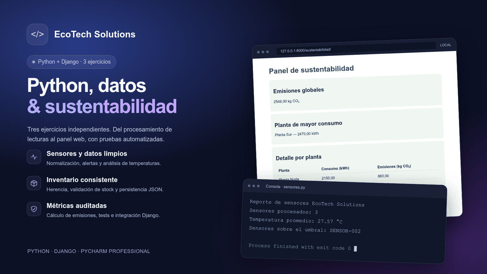

# EcoTech Solutions

**Desarrollado y probado en PyCharm Professional.** También se puede ejecutar desde una terminal, sin depender del IDE.

## Pruebas automatizadas

**26 pruebas** todas aprobadas durante la verificación local del proyecto:

| Ejercicio | Pruebas | Comprobaciones |
| --- | ---: | --- |
| Sensores | 8 | Limpieza, decimales, validaciones, alertas, promedio y lista vacía |
| Productos | 6 | Stock válido e inválido, herencia, ficha técnica y exportación JSON |
| Auditoría y web | 12 | Cálculos, excepciones, agregación, URL, contexto y plantilla |
| **Total** | **26** | **Todas aprobadas** |

Las pruebas utilizan **`unittest`** y las herramientas de testing de Django

